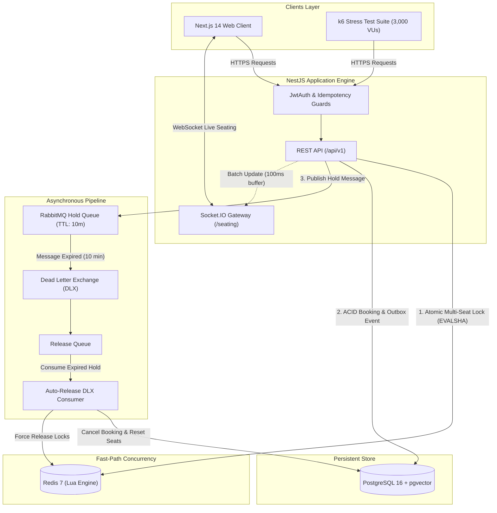

# Eventix – High-Concurrency Event Ticketing Platform

[](https://nestjs.com/)
[-4169E1?style=flat-square&logo=postgresql&logoColor=white)](https://github.com/pgvector/pgvector)
[](https://redis.io/)
[](https://www.rabbitmq.com/)
[](https://www.docker.com/)
[](https://nextjs.org/)
[](https://www.typescriptlang.org/)

Eventix là nền tảng bán vé sự kiện quy mô lớn với kiến trúc **Modular Monolith**, được thiết kế để giải quyết bài toán tranh chấp tài nguyên cao độ (high contention) trong các đợt mở bán chớp nhoáng (flash sales). Hệ thống kết hợp atomic distributed locks, hàng đợi bất đồng bộ với cơ chế tự giải phóng ghế, tìm kiếm sự kiện ngữ nghĩa bằng vector embedding và đồng bộ thời gian thực qua WebSockets.

---

## 1. System Architecture



---

## 2. Technical Highlights

### Atomic Seat Reservation & Deadlock Prevention
- **Redis Lua Scripts (EVALSHA):** Quá trình khóa nhiều ghế cùng lúc được thực hiện nguyên tử qua script Lua tải sẵn vào Redis memory. Kiểm tra và chiếm lock theo nguyên lý *All-or-Nothing* (chỉ cần 1 ghế bị trùng, toàn bộ thao tác lập tức rollback mà không giữ lock dở dang).
- **Deterministic ID Sorting:** Mảng danh sách ghế luôn được sắp xếp theo thứ tự từ điển (`sort()`) trước khi gửi vào Redis, loại bỏ hoàn toàn hiện tượng **Circular Wait Deadlock** khi hàng ngàn người dùng tranh chấp các ghế kề nhau.
- **Transactional Outbox & ACID Transactions:** Sau khi khóa Redis thành công, NestJS khởi tạo một transaction PostgreSQL duy nhất để chuyển trạng thái ghế sang `LOCKED`, tạo bản ghi đặt chỗ `PENDING` và ghi nhận sự kiện Outbox.

### Asynchronous Auto-Release Pipeline (RabbitMQ DLX)
- **Zero-Block Async Workers:** Không cần chạy cron job quét toàn bộ bảng DB gây lock I/O. Hệ thống sử dụng mô hình **Message TTL (600,000ms = 10 phút)** kết hợp **Dead Letter Exchange (DLX)** của RabbitMQ.
- **Tự động thu hồi vé:** Sau 10 phút, nếu người dùng không hoàn tất thanh toán, RabbitMQ tự động đẩy message sang `booking.release.queue`. Worker chuyên dụng sẽ hủy đơn, trả ghế về trạng thái `AVAILABLE` trong PostgreSQL và xóa lock trên Redis để phục vụ khách hàng tiếp theo.

### Hybrid Semantic Search with pgvector
- **Kết hợp SQL Relational + Cosine Distance:** Cho phép tìm kiếm sự kiện tự nhiên (ví dụ: *"nhạc sống cuối tuần này dưới 500k ở Hà Nội"*). Hệ thống bóc tách metadata thành bộ lọc SQL chuẩn (thành phố, khoảng giá, ngày giờ) kết hợp cùng độ tương đồng vector cosine (`1 - (e.embedding <=> vector)`) 1536 chiều trên index HNSW của PostgreSQL.

### Real-Time Seating Synchronization
- **Socket.IO Room Buffering:** Phòng sự kiện (`event:<eventId>`) phát sóng cập nhật ghế theo cơ chế **Batch Throttling 100ms**, gộp và loại bỏ các cập nhật trùng lặp trước khi gửi xuống client, ngăn ngừa quá tải băng thông khi có đột biến click.

---

## 3. Quick Start

### Điều kiện tiên quyết
- **Node.js**: v18+ hoặc v20+
- **Docker & Docker Compose**: v20+

### Bước 1: Chuẩn bị biến môi trường
```bash
# Tạo file cấu hình từ template mẫu
cp .env.example .env
cp .env.example backend/.env
```

### Bước 2: Khởi động hạ tầng với Docker Compose
```bash
# Khởi chạy PostgreSQL (pgvector), Redis và RabbitMQ
docker compose up -d

# Kiểm tra trạng thái các container
docker compose ps
```

### Bước 3: Khởi chạy Backend & Frontend

**Backend (NestJS):**
```bash
cd backend
npm install

# Khởi tạo schema và seed dữ liệu mẫu sự kiện & ghế ngồi
npx prisma generate
npx prisma migrate dev --name init
npx prisma db seed

# Khởi chạy server ở chế độ dev
npm run start:dev
```
> Backend API chạy tại: `http://localhost:4000/api/v1`

**Frontend (Next.js):**
```bash
cd ../frontend
npm install
npm run dev
```
> Web Client chạy tại: `http://localhost:3000`

---

## 4. Load Testing & Verification

Dự án đi kèm bộ kịch bản stress-test viết bằng [Grafana k6](https://k6.io/) mô phỏng **3,000 Virtual Users (VUs)** đồng thời tranh chấp **500 ghế hot** trong đợt flash sale.

```bash
# Chạy k6 stress test kịch bản flash sale burst
k6 run k6/flash_sale_test.js

# Hoặc truyền biến môi trường tùy chỉnh
k6 run -e TARGET_URL=http://localhost:4000 -e EVENT_ID=evt-cyber-symphony-2026 k6/flash_sale_test.js
```

### Tiêu chí nghiệm thu (SLA Invariants):
* **Zero Double-Booking:** Số lượng ghế được giữ thành công tuyệt đối $\le 500$.
* **Graceful Degradation:** Yêu cầu đến chậm được xử lý sạch sẽ bằng mã `HTTP 409 Conflict`, tỷ lệ lỗi máy chủ `5xx` duy trì $< 1\%$.
* **Sub-Second Latency:** Độ trễ `p95 < 500ms` trong suốt giai đoạn tải đỉnh.

---

## 5. API Reference Summary

| Method | Endpoint | Mô tả | Bảo mật / Guards |
|---|---|---|---|
| `POST` | `/api/v1/auth/guest-login` | Đăng nhập tài khoản demo / khách | Public |
| `POST` | `/api/v1/auth/login` | Xác thực người dùng bằng Email & Mật khẩu | Public |
| `POST` | `/api/v1/bookings/reserve` | Đặt giữ ghế nguyên tử (10 phút) | `JwtAuth`, `Idempotency`, `BotDetection` |
| `POST` | `/api/v1/bookings/confirm` | Thanh toán và chốt vé vĩnh viễn | `JwtAuth`, `Idempotency` |
| `GET` | `/api/v1/bookings/my-tickets`| Danh sách vé đã mua của người dùng | `JwtAuth` |
| `POST` | `/api/v1/bookings/:id/cancel`| Hủy vé và hoàn tiền tức thì về ví | `JwtAuth` |
| `GET` | `/api/v1/search/hybrid` | Tìm kiếm sự kiện Hybrid (SQL + pgvector) | Public |
| `GET` | `/api/v1/events/:id/seats` | Lấy sơ đồ trạng thái ghế sự kiện | Public |
| `WS` | `/seating` (`event:<id>`) | Kênh WebSocket cập nhật ghế thời gian thực | Public |

---

## 6. License
Dự án được phân phối dưới giấy phép [MIT](LICENSE).
