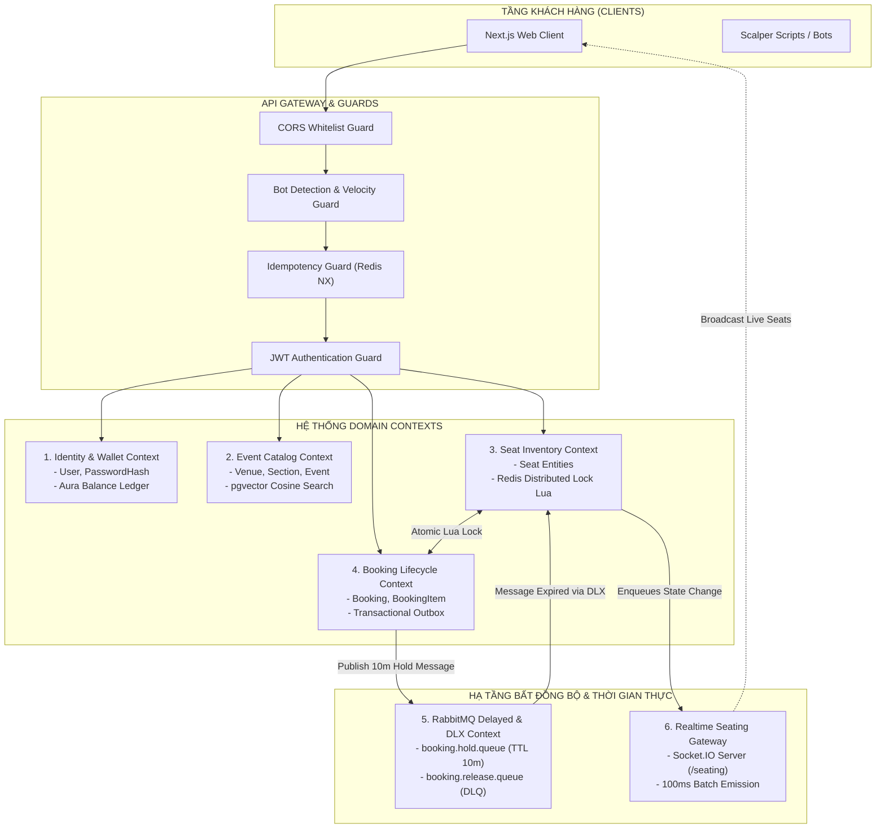
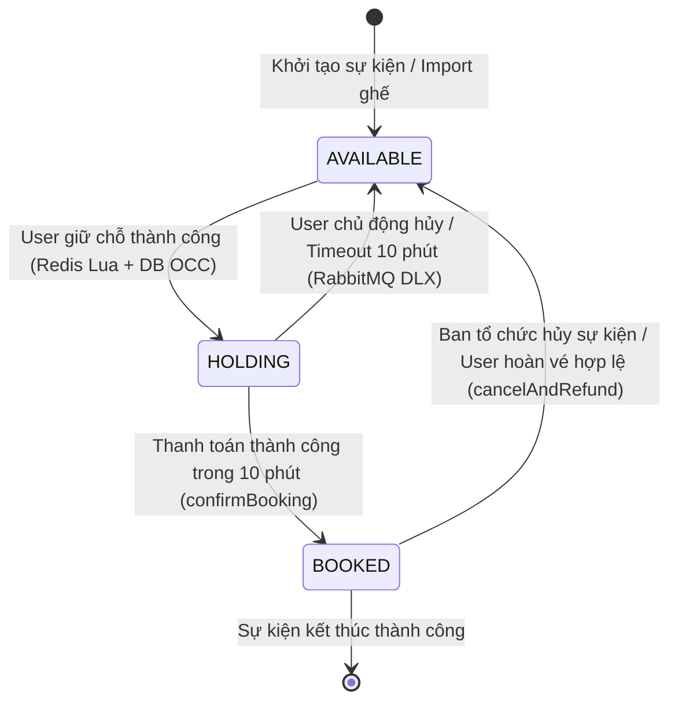
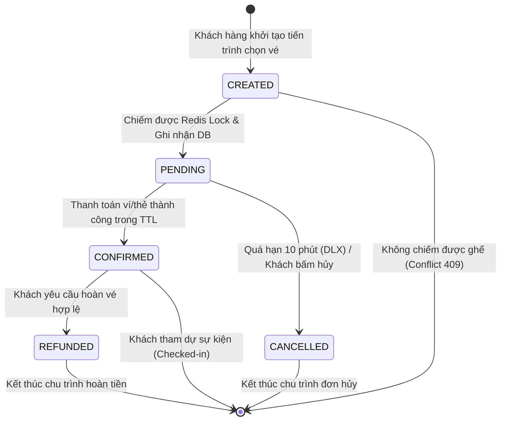
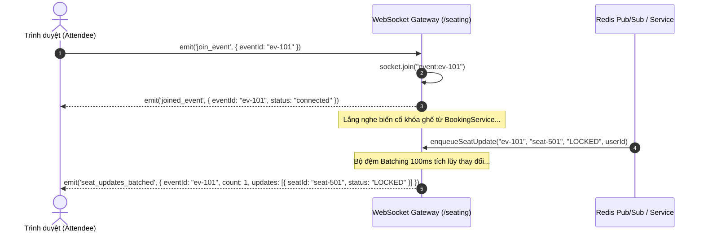
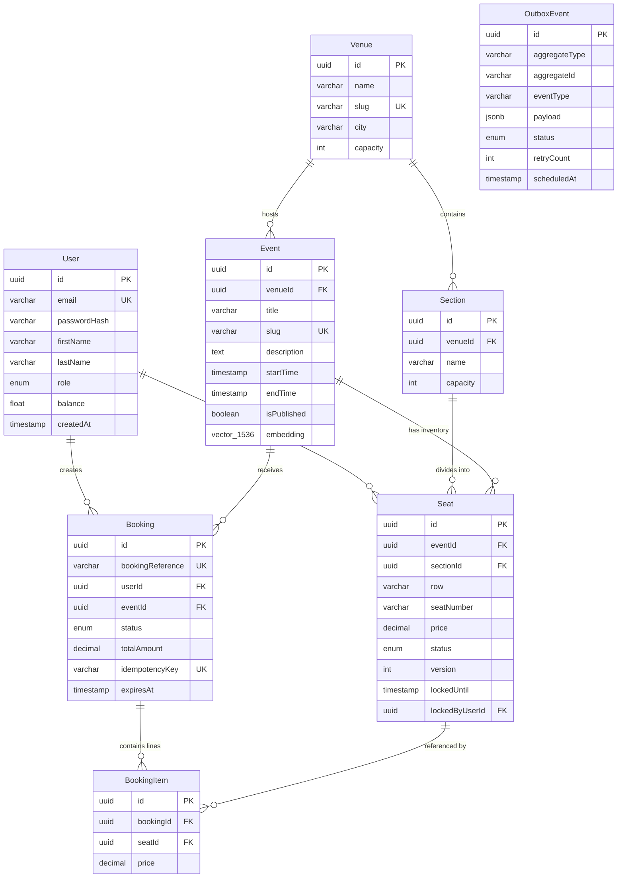
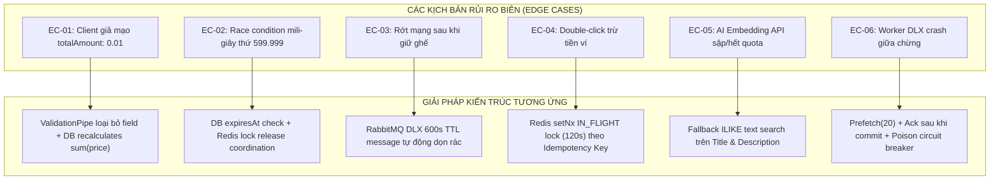

# BẢN ĐẶC TẢ YÊU CẦU PHẦN MỀM (SOFTWARE REQUIREMENTS SPECIFICATION - SRS)
## HỆ THỐNG PHÂN PHỐI VÉ SỰ KIỆN TRỰC TUYẾN CHỊU TẢI CAO (EVENTIX / AURATICKETS PLATFORM)

---

**Mã tài liệu:** SRS-EVTX-2026-v1.0  
**Tiêu chuẩn áp dụng:** IEEE Std 830-1998 (Recommended Practice for Software Requirements Specifications)  
**Cấp độ tài liệu:** Enterprise Architectural Blueprint & Systems Specification  
**Trạng thái:** RELEASED - BASELINE v1.0 & ENTERPRISE EXPANSION  
**Ngày hiệu lực:** 20/10/2026  
**Chủ quản hệ thống:** Solution Architecture & Core Engineering Team  

---

## MỤC LỤC TỔNG THỂ

1. [PHẦN 1: BỐI CẢNH NGHIỆP VỤ & PHẠM VI HỆ THỐNG](#phần-1-bối-cảnh-nghiệp-vụ--phạm-vi-hệ-thống)
2. [PHẦN 2: PHÂN RÃ MIỀN KIẾN TRÚC & QUYỀN SỞ HỮU DỮ LIỆU (BOUNDED CONTEXTS)](#phần-2-phân-rã-miền-kiến-trúc--quyền-sở-hữu-dữ-liệu-bounded-contexts)
3. [PHẦN 3: ĐẶC TẢ LUẬT NGHIỆP VỤ & STATE MACHINE (BUSINESS RULES & TRANSITIONS)](#phần-3-đặc-tả-luật-nghiệp-vụ--state-machine-business-rules--transitions)
4. [PHẦN 4: HỢP ĐỒNG API, DTO & GIAO THỨC TRUYỀN THÔNG (EXTERNAL INTERFACES)](#phần-4-hợp-đồng-api-dto--giao-thức-truyền-thông-external-interfaces)
5. [PHẦN 5: CƠ CHẾ CONCURRENCY, DISTRIBUTED LOCK & QUEUE ARCHITECTURE](#phần-5-cơ-chế-concurrency-distributed-lock--queue-architecture)
6. [PHẦN 6: THIẾT KẾ DỮ LIỆU, VECTOR EMBEDDINGS & TỐI ƯU HÓA INDEX](#phần-6-thiết-kế-dữ-liệu-vector-embeddings--tối-ưu-hóa-index)
7. [PHẦN 7: ĐẶC TẢ YÊU CẦU PHI CHỨC NĂNG (NFR) & CAM KẾT CHẤT LƯỢNG (SLA)](#phần-7-đặc-tả-yêu-cầu-phi-chức-năng-nfr--cam-kết-chất-lượng-sla)
8. [PHẦN 8: DANH MỤC VẤN ĐỀ RỦI RO & PHƯƠNG ÁN XỬ LÝ SỰ CỐ (EDGE CASES)](#phần-8-danh-mục-vấn-đề-rủi-ro--phương-án-xử-lý-sự-cố-edge-cases)
9. [PHẦN 9: KỊCH BẢN KIỂM THỬ (TEST PLANS) & TIÊU CHÍ NGHIỆM THU](#phần-9-kịch-bản-kiểm-thử-test-plans--tiêu-chí-nghiệm-thu)
10. [PHẦN 10: MA TRẬN TRUY VẾT & CÁC ĐIỂM QUYẾT ĐỊNH MỞ RỘNG (TBD)](#phần-10-ma-trận-truy-vết--các-điểm-quyết-định-mở-rộng-tbd)

---

# PHẦN 1: BỐI CẢNH NGHIỆP VỤ & PHẠM VI HỆ THỐNG

## 1.1 Bối cảnh & Động lực Dự án
Hệ thống **Eventix / AuraTickets** được xây dựng nhằm giải quyết bài toán cốt lõi trong ngành công nghiệp giải trí trực tuyến: **Bán vé trực tuyến trong các đợt Flash Sale / High-contention Events** (buổi hòa nhạc quy mô sân vận động, giải đấu thể thao quốc tế, lễ hội âm nhạc EDM).

Trong các sự kiện "Hot", lưu lượng truy cập có đặc tính bùng nổ theo hàm mũ (Spike Traffic) tăng vọt hàng trăm lần trong vài giây mở cổng bán vé:
- Hàng chục ngàn đến hàng triệu người dùng đồng thời (Concurrent Users) nhấp vào một nhóm ghế giới hạn (ghế VIP, ghế Fanzone sát sân khấu).
- Nếu sử dụng kiến trúc cơ sở dữ liệu quan hệ truyền thống (RDBMS row-locking `SELECT FOR UPDATE`), hệ thống sẽ lập tức rơi vào trạng thái nghẽn cổ chai (Deadlock / Lock Contention / Connection Pool Exhaustion).
- Nếu buông lỏng cơ chế kiểm soát đồng thời, nguy cơ bán trùng ghế (**Overbooking**) xảy ra, gây thiệt hại nghiêm trọng về tài chính, pháp lý và uy tín thương hiệu của Ban tổ chức.

Mục tiêu của Eventix là thiết lập một nền tảng bán vé phân tán, đảm bảo tính nhất quán tuyệt đối về dữ liệu (ACID & Strong Consistency trong đặt ghế), đồng thời duy trì độ trễ phản hồi cực thấp (< 50ms ở tầng phân tán) và trải nghiệm thời gian thực (Real-time Seating Map) cho khán giả.

---

## 1.2 Ranh giới Sản phẩm (System Boundaries & Scope)

### 1.2.1 Phạm vi Triển khai Baseline v1.0 (In-Scope)
1. **Quản lý Danh mục Sự kiện & Khán đài (Event & Venue Catalog):** Quản lý không gian địa điểm (Venue), phân khu (Sections), sơ đồ ghế chi tiết (Seat Matrix).
2. **Cơ chế Khóa phân tán Ghế ngồi (Distributed Seat Locking Engine):** Ứng dụng Redis 7 với giải thuật Lua Script nguyên tử (All-or-Nothing Atomic Lock) bảo vệ việc chọn ghế dưới độ trễ mili-giây.
3. **Quản lý Vòng đời Giữ vé (Ticket Holding via Delayed Queue):** Tích hợp RabbitMQ Dead Letter Exchange (DLX) với TTL 600 giây (10 phút) để tự động thu hồi ghế nếu khách hàng không hoàn tất thanh toán.
4. **Hai luồng Đặt vé Linh hoạt:**
   - *Luồng Giữ chỗ - Thanh toán (Reserve & Confirm Flow):* Dành cho mua vé có chọn ghế chi tiết trên sơ đồ.
   - *Luồng Đặt trực tiếp (Direct Booking Flow):* Dành cho đặt vé nhanh có khóa Redis tự động bảo vệ.
5. **Ví Nội bộ (Aura Wallet Balance Ledger):** Quản lý số dư người dùng nội bộ, nạp tiền an toàn, trừ tiền nguyên tử và hoàn tiền tự động khi hủy vé.
6. **Tìm kiếm Ngữ nghĩa Lai (Hybrid Semantic Search):** Kết hợp tìm kiếm từ khóa SQL truyền thống với tìm kiếm tương đồng vector Cosine Distance 1536 chiều bằng `pgvector` và mô hình nhúng Gemini / OpenAI.
7. **Cập nhật Trạng thái Sơ đồ Ghế Thời gian thực (Real-time Seating Sync):** WebSocket Gateway (Socket.IO) phân chia room theo từng sự kiện, gom cụm (batching) bản tin 100ms phát tán trạng thái ghế `AVAILABLE`, `HOLDING`, `BOOKED`.
8. **Phòng chống Bot & Đầu cơ (Bot Mitigation):** Đo lường trắc sinh học tương tác chuột, độ trễ phản xạ và giới hạn tần suất gọi API (Sliding-window Velocity Rate Limiting).
9. **Tính Lũy đẳng Giao dịch (Transaction Idempotency):** Khóa chống gửi trùng request qua `X-Idempotency-Key` bảo vệ dòng tiền và ghế ngồi.

### 1.2.2 Tạm thời Ngoài phạm vi (Out-of-Scope - Dành cho các phiên bản tương lai)
1. **Thị trường Thứ cấp Chợ đen P2P (Secondary Ticket Exchange):** Sàn giao dịch bán lại vé giữa người dùng với người dùng có tính năng trượt giá động (Dynamic resale pricing).
2. **Đấu giá Vé Trực tiếp (Live Ticket Bidding):** Cơ chế đấu giá tăng dần cho các vị trí đặc biệt (Presidential Box / Meet & Greet).
3. **Cổng Thanh toán Quốc tế Đa tiền tệ Thực tế (Live Multi-Currency PSP):** Tích hợp Visa/Mastercard 3D-Secure 2.0, PayPal, VNPay, MoMo (v1.0 sử dụng Ví Aura Wallet và mô phỏng Stripe Card Settlement).
4. **Hệ thống Soát vé Vật lý & In vé Nhiệt tại Quầy (Hardware POS Box-Office & Turnstile Scanners):** Đầu đọc mã vạch phần cứng tại cổng sân vận động.

---

## 1.3 Ma trận Phân tích Tác nhân (Actors Matrix)

| Mã tác nhân | Tên tác nhân | Vai trò & Mục tiêu nghiệp vụ | Quyền hạn truy cập & Ràng buộc an ninh |
| :--- | :--- | :--- | :--- |
| **ACT-01** | **Khách vãng lai (Anonymous Guest)** | Duyệt danh mục sự kiện, tìm kiếm sự kiện bằng ngôn ngữ tự nhiên, quan sát sơ đồ ghế thời gian thực trước khi quyết định mua. | Chỉ đọc (Read-only). Không được giữ ghế, không được gọi API giao dịch tài chính. Bị áp đặt Rate limit chặt theo IP. |
| **ACT-02** | **Khách hàng (Customer / Buyer)** | Chọn ghế, giữ vé 10 phút, thanh toán qua ví Aura, xem vé đã mua, xuất QR code, chuyển nhượng vé cho bạn bè, yêu cầu hủy/hoàn vé. | Xác thực qua JWT Bearer Token. Được quản lý đơn hàng của chính mình. Giới hạn tối đa 10 vé/sự kiện. |
| **ACT-03** | **Ban tổ chức (Event Organizer)** | Thiết lập cấu hình khán đài, định giá từng phân khu/hàng ghế, thiết lập thời gian mở bán Flash Sale, theo dõi doanh thu và tỷ lệ lấp đầy ghế. | Xác thực với vai trò `ORGANIZER`. Chỉ được thao tác trên các sự kiện do chính mình khởi tạo hoặc được ủy quyền. |
| **ACT-04** | **Quản trị viên Hệ thống (System Admin)** | Giám sát sức khỏe hạ tầng, can thiệp xử lý sự cố kẹt lock, cấu hình danh sách đen (Blacklist IP/User), quản trị Outbox dispatcher, cưỡng chế hoàn tiền khi sự kiện bị hủy bỏ. | Toàn quyền (`ADMIN`). Truy cập được các API can thiệp sâu (`forceReleaseSeats`, purge cache, kiểm toán audit logs). |

---

# PHẦN 2: PHÂN RÃ MIỀN KIẾN TRÚC & QUYỀN SỞ HỮU DỮ LIỆU (BOUNDED CONTEXTS)

Kiến trúc Eventix được phân rã theo nguyên lý Domain-Driven Design (DDD), chia tách ranh giới rõ ràng giữa 6 Bounded Contexts. Mỗi Context chịu trách nhiệm quản lý một tập thực thể độc lập và tuyệt đối tuân thủ nguyên tắc **Single Source of Truth (SSOT)**.



---

## 2.1 Phân rã Chi tiết 6 Bounded Contexts

### 1. Identity & Wallet Context
* **Trách nhiệm:** Quản lý vòng đời định danh người dùng, xác thực (Authentication), cấp phát/kiểm tra phiên làm việc (JWT) và quản lý số dư ví nội bộ (Aura Wallet Ledger).
* **Thực thể dữ liệu sở hữu:** `User` (email, passwordHash, firstName, lastName, role, balance, timestamps).
* **Ràng buộc:** Chỉ context này được quyền cập nhật trường `balance`. Mọi thao tác trừ/cộng tiền từ Booking Context phải thông qua giao dịch ACID có kiểm tra số dư.

### 2. Event Catalog & pgvector Semantic Search Context
* **Trách nhiệm:** Quản lý không gian biểu diễn (Venue, sức chứa, địa chỉ), cấu trúc khán đài (Section), lịch trình biểu diễn (Event), và sinh vector embedding ngữ nghĩa 1536 chiều từ mô hình AI phục vụ tìm kiếm thông minh.
* **Thực thể dữ liệu sở hữu:** `Venue`, `Section`, `Event` (title, description, startTime, endTime, bannerUrl, isPublished, embedding).
* **Ràng buộc:** Bảng `Event` là nguồn dữ liệu chỉ đọc (read-only) đối với các giao dịch đặt vé; việc cập nhật thông tin sự kiện chỉ dành cho Organizer/Admin.

### 3. Seat Inventory & Distributed Lock Context
* **Trách nhiệm:** Quản lý trạng thái tồn kho của từng ghế ngồi trong thời gian thực. Cung cấp cơ chế phân xử tranh chấp chỗ ngồi (Conflict Resolution) với độ trễ siêu thấp bằng Redis Lua Script Engine và Optimistic Concurrency Control (OCC) ở Database.
* **Thực thể dữ liệu sở hữu:** 
  * CSDL Quan hệ: `Seat` (id, eventId, sectionId, row, seatNumber, price, status, version, lockedUntil, lockedByUserId).
  * Bộ nhớ phân tán Redis: Key không gian `lock:event:{eventId}:seat:{seatId}` mang payload JSON `{ userId, status, lockedAt }`.
* **Ràng buộc:** Không một đơn hàng nào được phép tạo nếu chưa chiếm được khóa phân tán từ context này.

### 4. Booking Lifecycle Context
* **Trách nhiệm:** Điều phối toàn bộ quy trình mua vé (State Machine của đơn hàng). Chịu trách nhiệm ghi nhận hợp đồng bán vé, liên kết danh sách ghế đặt chỗ, kích hoạt trừ tiền ví và ghi nhận biến cố vào bảng Outbox.
* **Thực thể dữ liệu sở hữu:** `Booking` (id, bookingReference, userId, eventId, status, totalAmount, idempotencyKey, expiresAt), `BookingItem` (id, bookingId, seatId, price), `OutboxEvent` (aggregateType, aggregateId, eventType, payload, status).
* **Ràng buộc:** Đơn hàng là thực thể trung tâm gắn kết tiền nong và ghế ngồi. Giá vé trong đơn hàng bắt buộc phải được tính toán từ cơ sở dữ liệu ghế, cấm nhận giá từ client.

### 5. RabbitMQ Asynchronous & DLX Context
* **Trách nhiệm:** Cung cấp hạ tầng đếm ngược thời gian giữ vé 10 phút đáng tin cậy (Reliable Delay Queue). Tự động kích hoạt cơ chế thu hồi ghế và hủy đơn khi khách hàng quá hạn thanh toán mà không làm tiêu tốn tài nguyên polling của CPU.
* **Thực thể hạ tầng sở hữu:** 
  * Exchange: `booking.hold.exchange`, `booking.dlx.exchange`.
  * Queues: `booking.hold.queue` (TTL 600.000ms), `booking.release.queue` (Dead Letter Queue).
* **Ràng buộc:** Worker lắng nghe DLQ phải có cơ chế ngắt mạch chống lặp vô tận (Poison message circuit breaking).

### 6. Realtime Seating Gateway Context
* **Trách nhiệm:** Duy trì kết nối hai chiều liên tục (Full-duplex WebSocket) với hàng chục ngàn trình duyệt client. Tiếp nhận các biến cố thay đổi trạng thái ghế từ Inventory Context, gom cụm (batch) và phát sóng (broadcast) tới đúng phòng của sự kiện (`event:{eventId}`).
* **Hạ tầng sở hữu:** Socket.IO Namespace `/seating`, bộ đệm in-memory `pendingUpdates Map`, đồng hồ định kỳ `flushIntervalTimer` (100ms).
* **Ràng buộc:** Không được phát từng bản tin đơn lẻ gây nghẽn Socket I/O; bắt buộc phải gom cụm theo chu kỳ 100ms.

---

## 2.2 Ràng buộc Sở hữu Dữ liệu (Data Governance & Zero Cross-Contamination)

| Bảng Dữ liệu | Context Sở hữu Tuyệt đối | Quyền Đọc (Read) | Quyền Ghi (Write) | Quy định Truy cập Trái phép |
| :--- | :--- | :--- | :--- | :--- |
| **`User`** | Identity & Wallet | Mọi Context | Duy nhất Identity & Wallet Context | Nghiêm cấm Booking Context tự ý cập nhật `User.balance` bằng câu lệnh UPDATE rời rạc ngoài Transaction có kiểm tra số dư. |
| **`Event` / `Venue`** | Event Catalog | Mọi Context | Catalog Context (Organizer/Admin) | Booking Context chỉ được đọc thông tin sự kiện để hiển thị và xác thực tồn tại. |
| **`Seat`** | Seat Inventory | Mọi Context | Seat Inventory Context & Booking Transaction | Trạng thái ghế chỉ được chuyển sang `BOOKED` khi đã giữ khóa thành công ở Redis. |
| **`Booking` / `BookingItem`** | Booking Lifecycle | Booking Context | Duy nhất Booking Lifecycle Context | Không service nào được phép tự ý thay đổi trạng thái Booking ngoài bộ điều phối `BookingService`. |
| **`OutboxEvent`** | Booking Lifecycle | Outbox Dispatcher | Booking Lifecycle Context | Ghi nhận trong cùng một Transaction vật lý với `Booking` (ACID Local Transaction). |

---

# PHẦN 3: ĐẶC TẢ LUẬT NGHIỆP VỤ & STATE MACHINE (BUSINESS RULES & TRANSITIONS)

## 3.1 Bộ Quy tắc Nghiệp vụ Bất di Bất dịch (Core Business Rules BR-001 đến BR-020)

### BR-001: Zero Overbooking Guarantee (Chống bán trùng tuyệt đối)
Một vị trí ghế vật lý xác định bởi bộ tứ `(eventId, sectionId, row, seatNumber)` tại một thời điểm chỉ có thể thuộc về **tối đa một** khách hàng duy nhất. Tuyệt đối không có bất kỳ ngoại lệ nào cho phép 2 khách hàng đồng thời giữ hoặc sở hữu cùng một ghế.

### BR-002: Server-Side Pricing Authority (Thẩm quyền giá vé tuyệt đối từ Máy chủ)
Giá vé của từng ghế và tổng giá trị đơn hàng (`totalAmount`) hoàn toàn do hệ thống backend tính toán dựa trên dữ liệu lưu trong cơ sở dữ liệu. **Cấm tuyệt đối** việc nhận giá vé hoặc tổng tiền từ Client gửi lên thông qua Body API. Bất kỳ request nào cố tình đính kèm trường giá vé sẽ bị loại bỏ hoặc từ chối hợp lệ ngay tại tầng ValidationPipe.

### BR-003: All-or-Nothing Atomic Seat Locking (Khóa ghế nguyên tử toàn phần)
Khách hàng được phép đặt nhiều ghế trong một giao dịch (tối đa 10 ghế). Cơ chế khóa ghế phân tán phải tuân thủ nguyên tắc All-or-Nothing: Nếu có 10 ghế được chọn mà chỉ cần 1 ghế đã bị người khác khóa trước đó, toàn bộ thao tác giữ chỗ phải thất bại hoàn toàn. Hệ thống không khóa dở dang 9 ghế còn lại.

### BR-004: Strict Lock Time-To-Live (TTL Giữ chỗ nghiêm ngặt 600 giây)
Thời hạn giữ chỗ tạm thời cho mỗi phiên đặt vé là đúng 600 giây (10 phút). Trong 10 phút này, ghế được bảo vệ khỏi tất cả người dùng khác. Nếu hết 600 giây mà đơn hàng chưa được thanh toán, quyền mua vé bị hủy bỏ và ghế tự động hoàn trả vào kho khả dụng.

### BR-005: Ticket Purchase Limit Per Transaction (Hạn mức vé trên một giao dịch)
Để chống lại hành vi đầu cơ vé (scalping), mỗi giao dịch giữ vé chỉ được phép chọn tối thiểu 1 ghế và tối đa **10 ghế**. Danh sách ID ghế phải là mảng UUID hợp lệ và không chứa các phần tử trùng lặp.

### BR-006: Transaction Idempotency Enforcement (Bắt buộc Tính Lũy đẳng)
Tất cả các API làm thay đổi trạng thái tài chính và giữ chỗ (`/bookings/reserve`, `/bookings/confirm`, `/bookings` Direct) bắt buộc phải đính kèm Header `X-Idempotency-Key` (chuỗi định danh ngẫu nhiên UUIDv4 do client sinh ra). Nếu client gửi lại cùng một key trong vòng 24 giờ:
- Nếu request ban đầu đang xử lý: Trả về HTTP `409 Conflict`.
- Nếu request ban đầu đã thành công: Trả lại kết quả đã cache mà không thực thi lại logic trừ tiền hay ghi DB lần hai.

### BR-007: Sufficient Wallet Balance Enforcement (Bắt buộc Đủ số dư Ví)
Khi thanh toán bằng phương thức ví nội bộ (`WALLET`), số dư của khách hàng (`User.balance`) phải lớn hơn hoặc bằng tổng giá trị đơn vé. Việc kiểm tra số dư và trừ tiền phải nằm trong một ACID Transaction nguyên tử.

### BR-008: Non-Negative Wallet Top-up (Ngăn chặn Nạp tiền Âm và Giới hạn Nạp)
Hệ thống cấm tuyệt đối các thao tác nạp tiền ví có giá trị âm hoặc bằng 0. Mỗi giao dịch nạp tiền ví qua endpoint `/auth/top-up` phải có giá trị tối thiểu là **$1.00** và tối đa không vượt quá **$10,000.00**.

### BR-009: Automated Inventory Reversion on Refund (Tự động hoàn trả kho khi Hủy đơn)
Khi một đơn hàng đã thanh toán (`CONFIRMED`) bị hủy bỏ hợp lệ (`REFUNDED`), số tiền tương ứng được hoàn trả nguyên vẹn 100% vào ví của người dùng, đồng thời toàn bộ các ghế liên kết phải lập tức chuyển trạng thái về `AVAILABLE` ở cả Postgres và Redis, sau đó phát tín hiệu qua WebSocket thông báo cho toàn bộ cộng đồng.

### BR-010: Ticket Transfer Verification & Invalidation (Xác thực Chuyển nhượng vé)
Chỉ các vé thuộc đơn hàng `CONFIRMED` mới có quyền chuyển nhượng cho người khác. Khách hàng không được chuyển nhượng vé cho chính địa chỉ email của mình. Khi chuyển nhượng thành công, quyền truy cập vé của người gửi lập tức bị vô hiệu hóa và chuyển giao toàn quyền sang người nhận.

### BR-011: Event Publishing Boundary (Ranh giới Mở bán Sự kiện)
Chỉ các sự kiện có cờ `isPublished = true` và thời gian hiện tại nằm trước `endTime` mới được phép thực hiện tìm kiếm, hiển thị và đặt vé. Các sự kiện bản nháp (Draft) hoặc đã kết thúc hoàn toàn bị chặn ở tầng nghiệp vụ.

### BR-012: Lock Ownership Release (Quyền hạn Nhả Khóa)
Người dùng chỉ có thể chủ động hủy/nhả khóa cho các ghế do chính User ID của mình đang nắm giữ trong phiên làm việc. Hệ thống kiểm tra ID người giữ khóa trước khi thực thi lệnh mở khóa; chỉ có Worker hệ thống (DLX Consumer) hoặc Quản trị viên mới có quyền cưỡng chế nhả khóa (`FORCE` release).

### BR-013: Queue-driven Asynchronous Release (Thu hồi Bất đồng bộ qua Hàng đợi)
Hệ thống không sử dụng các tiến trình cronjob quét cơ sở dữ liệu liên tục để tìm ghế hết hạn (tránh Full Table Scan). Việc thu hồi ghế hết hạn bắt buộc phải được dẫn dắt bởi kiến trúc hàng đợi sự kiện (Event-driven via RabbitMQ DLX).

### BR-014: Poison Message Quarantine (Cách ly Tin nhắn Độc hại)
Worker xử lý message quá hạn từ RabbitMQ nếu gặp lỗi không thể khắc phục (Poison Message / Lỗi cú pháp dữ liệu), sau tối đa **3 lần retry** bắt buộc phải bị loại bỏ (`nack` với `requeue = false`) hoặc đưa vào hàng đợi cách ly. Tuyệt đối không gọi `nack(requeue = true)` vô hạn gây tắc nghẽn CPU.

### BR-015: In-Memory Aggregation Ban (Cấm tính toán tổng hợp trong RAM Node.js)
Nghiêm cấm việc kéo toàn bộ hàng chục ngàn dòng dữ liệu ghế (`Seat`) về RAM của ứng dụng Node.js chỉ để tính giá vé thấp nhất (`minPrice`) hoặc đếm số ghế trống. Các thao tác này bắt buộc phải sử dụng hàm tổng hợp của SQL Database (`MIN`, `COUNT GROUP BY`) hoặc lưu trữ bộ đếm tổng hợp trong Redis Cache.

### BR-016: Explicit CORS Whitelisting (Tường lửa CORS Danh sách trắng)
Hệ thống cấm cấu hình CORS mở tự do (`origin: true` hoặc `origin: '*'`) đi kèm cờ `credentials: true` trên môi trường Production. Danh sách Domain được phép gọi API phải được cấu hình tường minh thông qua danh sách trắng (Whitelist) gồm Domain Frontend chính thức và localhost môi trường phát triển.

### BR-017: Secure Token Lifecycle (Vòng đời Token An toàn)
Access Token JWT phải có thời hạn hiệu lực giới hạn, mang đầy đủ các claims nhận diện tối thiểu (`sub`, `email`, `role`). Nghiêm cấm việc fallback về các chuỗi secret key mặc định dễ đoán nếu môi trường thiếu biến `JWT_SECRET`.

### BR-018: Transactional Outbox Pattern (Đảm bảo Xuất bản Sự kiện Đáng tin cậy)
Mọi biến cố làm thay đổi trạng thái đơn hàng (`booking.created`, `booking.confirmed`, `booking.refunded`, `booking.expired_timeout`) bắt buộc phải được ghi đồng thời vào bảng `OutboxEvent` bên trong cùng một Transaction vật lý của Database, đảm bảo tính nhất quán cuối cùng (Eventual Consistency) giữa Database và Message Broker.

### BR-019: Bot Velocity Rate-Limiting (Kiểm soát Tốc độ Đặt chỗ chống Bot)
Hệ thống áp dụng thuật toán Sliding-Window trên Redis để khống chế tốc độ gọi API đặt chỗ. Mỗi địa chỉ IP chỉ được phép thực hiện tối đa **6 lượt yêu cầu giữ chỗ trong vòng 10 giây**. Các lượt gọi vượt ngưỡng sẽ bị tính điểm rủi ro bot và tự động điều hướng sang Honeypot.

### BR-020: Connection Pooling Discipline (Kỷ luật Kết nối Cơ sở Dữ liệu)
Ứng dụng phải tuân thủ nghiêm ngặt giới hạn kết nối của Supabase PgBouncer (cổng 6543) bằng cách cấu hình tường minh tham số `connection_limit=20` trong chuỗi kết nối. Không để các instance backend tự do mở số kết nối vượt quá hạn ngạch phần cứng của máy chủ DB.

---

## 3.2 Ma trận Chuyển trạng thái Ghế (Seat State Machine)



### Bảng Chi tiết Chuyển trạng thái Ghế:

| Trạng thái hiện tại | Biến cố kích hoạt (Trigger) | Trạng thái tiếp theo | Điều kiện ràng buộc (Guard Conditions) | Hành động thực thi (System Actions) |
| :--- | :--- | :--- | :--- | :--- |
| **AVAILABLE** | Khách hàng bấm giữ vé (`POST /bookings/reserve`) | **HOLDING** | - Ghế đang có status = `AVAILABLE`<br>- Redis key chưa tồn tại (`EXISTS = 0`)<br>- Hạn mức đơn <= 10 ghế | - Chạy Lua Script SET Redis key với TTL 600s.<br>- Update DB Seat status = `LOCKED`, lockedUntil = now + 600s, version = version + 1.<br>- Bắn message 10 phút vào `booking.hold.queue`.<br>- Broadcast WebSocket `LOCKED`. |
| **HOLDING** | Khách hàng thanh toán thành công (`POST /bookings/confirm`) | **BOOKED** | - Đơn hàng đang `PENDING`<br>- Thời gian hiện tại < `expiresAt`<br>- Số dư ví người mua đủ chi trả | - Update DB Seat status = `BOOKED`, xóa `lockedUntil`, version = version + 1.<br>- Xóa key giữ chỗ trên Redis (`forceReleaseSeats`).<br>- Ghi Outbox `booking.confirmed`.<br>- Broadcast WebSocket `BOOKED`. |
| **HOLDING** | Hết hạn 10 phút (RabbitMQ DLX kích hoạt) | **AVAILABLE** | - Đơn hàng vẫn ở trạng thái `PENDING`<br>- Không có giao dịch thanh toán nào thành công | - Update DB Seat status = `AVAILABLE`, xóa `lockedUntil`, version = version + 1.<br>- Xóa key Redis.<br>- Update đơn hàng sang `CANCELLED`.<br>- Broadcast WebSocket `AVAILABLE`. |
| **HOLDING** | Khách hàng chủ động hủy giữ chỗ | **AVAILABLE** | - `userId` yêu cầu phải trùng khớp với `lockedByUserId` | - Xóa key Redis có đối soát sở hữu.<br>- Hoàn trả trạng thái ghế DB về `AVAILABLE`.<br>- Broadcast WebSocket `AVAILABLE`. |
| **BOOKED** | Khách hàng hủy vé / BTC hoàn tiền (`POST /bookings/:id/cancel`) | **AVAILABLE** | - Đơn hàng đang ở trạng thái `CONFIRMED`<br>- `userId` sở hữu hợp pháp vé | - Hoàn 100% tiền vào ví User.<br>- Update DB Seat status = `AVAILABLE`, version = version + 1.<br>- Ghi Outbox `booking.refunded`.<br>- Broadcast WebSocket `AVAILABLE`. |

---

## 3.3 Ma trận Chuyển trạng thái Đơn hàng (Booking State Machine)



### Bảng Chi tiết Chuyển trạng thái Đơn hàng:

| Trạng thái hiện tại | Biến cố kích hoạt (Trigger) | Trạng thái tiếp theo | Điều kiện kiểm tra (Guards) | Hành vi nghiệp vụ tương ứng |
| :--- | :--- | :--- | :--- | :--- |
| **(Non-existent)** | Gọi API `POST /bookings/reserve` | **PENDING** | - Chiếm thành công Distributed Lock trên toàn bộ ghế.<br>- Tất cả ghế đều khả dụng. | - Sinh mã `bookingReference` duy nhất.<br>- Tạo bản ghi `Booking` với status `PENDING`.<br>- Tạo các bản ghi `BookingItem`.<br>- Thiết lập `expiresAt = now + 600s`. |
| **PENDING** | Gọi API `POST /bookings/confirm` | **CONFIRMED** | - Đơn hàng tồn tại và thuộc quyền sở hữu của User.<br>- Thời gian chưa vượt quá `expiresAt`.<br>- Trừ tiền ví thành công. | - Chuyển Booking status sang `CONFIRMED`.<br>- Chuyển toàn bộ ghế sang `BOOKED`.<br>- Xóa khóa tạm thời trên Redis.<br>- Xuất vé điện tử QR Code. |
| **PENDING** | Message từ DLQ được tiêu thụ sau 10 phút | **CANCELLED** | - Trạng thái đơn hàng vẫn là `PENDING` (chưa thanh toán). | - Chuyển Booking status sang `CANCELLED`.<br>- Thu hồi ghế về `AVAILABLE`.<br>- Ghi nhận Outbox event hủy đơn. |
| **CONFIRMED** | Gọi API `POST /bookings/:id/cancel` | **REFUNDED** | - Đơn hàng đang `CONFIRMED`.<br>- Người yêu cầu là chủ sở hữu hợp pháp.<br>- Sự kiện chưa diễn ra. | - Chuyển Booking status sang `REFUNDED`.<br>- Cộng trả lại 100% tiền vào số dư ví `User.balance`.<br>- Đưa toàn bộ ghế liên kết về `AVAILABLE`. |

---

# PHẦN 4: HỢP ĐỒNG API, DTO & GIAO THỨC TRUYỀN THÔNG (EXTERNAL INTERFACES)

## 4.1 Quy chuẩn Thiết kế RESTful API v1
- **Base URI:** `http(s)://{host}:{port}/api/v1`
- **Quy tắc Header Bắt buộc:**
  - `Content-Type: application/json`
  - `Authorization: Bearer <jwt_access_token>` (dành cho các endpoint bảo vệ)
  - `X-Idempotency-Key: <uuid_v4>` (bắt buộc cho tất cả các giao dịch POST tạo chỗ, xác nhận thanh toán)
  - `X-Interaction-Latency: <milliseconds>` (telemetry đánh giá bot)
  - `X-Mouse-Entropy: <float_0_to_1>` (telemetry trắc sinh học chuột)

### Bảng Danh mục HTTP Status Codes Chuẩn tắc:
- `200 OK`: Yêu cầu xử lý thành công, trả về dữ liệu tương ứng.
- `201 Created`: Tài nguyên mới đã được tạo thành công (đơn hàng, tài khoản).
- `400 Bad Request`: Dữ liệu đầu vào vi phạm quy tắc DTO (sai định dạng, số âm, thiếu trường bắt buộc).
- `401 Unauthorized`: Token xác thực bị thiếu, không hợp lệ hoặc đã hết hạn.
- `403 Forbidden`: Người dùng không có quyền truy cập tài nguyên của người khác hoặc vai trò không đủ quyền.
- `404 Not Found`: Không tìm thấy thực thể (Sự kiện, Ghế, Đơn hàng) theo ID/Slug cung cấp.
- `409 Conflict`: Xung đột tài nguyên (Ghế đã bị người khác khóa trước, trùng Idempotency key đang xử lý).
- `422 Unprocessable Entity`: Dữ liệu đúng cú pháp nhưng vi phạm luật nghiệp vụ (Ví dụ: Không đủ số dư ví).
- `429 Too Many Requests`: Vượt quá ngưỡng Rate Limit cho phép.
- `500 Internal Server Error`: Lỗi hệ thống nội bộ chưa được xử lý.

### Cấu trúc Định dạng Lỗi Thống nhất (Standard Error Envelope):
```json
{
  "statusCode": 409,
  "errorCode": "SEAT_LOCK_CONFLICT",
  "message": "One or more of the selected seats are currently locked by another user.",
  "timestamp": "2026-10-20T08:30:00.125Z",
  "path": "/api/v1/bookings/reserve",
  "correlationId": "req-98f21a4e-128b-4c22-9df7",
  "errorDetails": {
    "conflictingSeatId": "e3b0c442-98fc-1c14-9af0-2b9049445123",
    "retryAfterSeconds": 5
  }
}
```

---

## 4.2 Chi tiết Đặc tả Hợp đồng API Danh mục v1

### Nhóm 1: Xác thực & Tài khoản (Authentication & Wallet)

#### 1. Đăng ký tài khoản (`POST /auth/register`)
- **Request Body (RegisterDto):**
  ```json
  {
    "email": "user@example.com",
    "password": "Password123!",
    "firstName": "John",
    "lastName": "Doe"
  }
  ```
- **Validation Rules:**
  - `email`: `@IsEmail()`, chuẩn hóa lowercase và trim khoảng trắng.
  - `password`: `@IsString()`, `@MinLength(6)`.
  - `firstName`, `lastName`: `@IsString()`, `@IsNotEmpty()`.
- **Response (201 Created):**
  ```json
  {
    "accessToken": "eyJhbGciOi...",
    "user": {
      "id": "u-uuid-1234",
      "email": "user@example.com",
      "firstName": "John",
      "lastName": "Doe",
      "role": "CUSTOMER",
      "balance": 1000.0
    }
  }
  ```

#### 2. Nạp tiền ví Aura (`POST /auth/top-up`)
- **Header:** `Authorization: Bearer <token>`
- **Request Body (TopUpDto):**
  ```json
  {
    "amount": 250.00
  }
  ```
- **Validation Rules:**
  - `amount`: `@IsOptional()`, `@IsNumber()`, `@Min(1, { message: 'Số tiền nạp tối thiểu là $1' })`, `@Max(10000, { message: 'Số tiền nạp tối đa mỗi giao dịch là $10,000' })`.
- **Response (200 OK):** Trả về đối tượng user đã cập nhật số dư mới chính xác.

---

### Nhóm 2: Sự kiện & Tìm kiếm (Events & Semantic Search)

#### 1. Lấy danh sách sự kiện (`GET /events`)
- **Query Params:** `limit` (default: 100), `offset` (default: 0), `category` (optional).
- **Cơ chế Caching:** Tích hợp Redis Cache TTL 120 giây theo key `cache:events:all:{limit}:{offset}:{category}`.
- **Response (200 OK):**
  ```json
  {
    "total": 54,
    "limit": 100,
    "offset": 0,
    "events": [
      {
        "id": "ev-uuid-001",
        "title": "Coldplay - Music of the Spheres World Tour",
        "slug": "coldplay-world-tour-2026",
        "minPrice": 85.00,
        "maxPrice": 450.00,
        "availableSeats": 1420,
        "totalSeats": 50000
      }
    ]
  }
  ```

#### 2. Tìm kiếm ngữ nghĩa lai (`POST /search/hybrid`)
- **Request Body (HybridSearchQueryDto):**
  ```json
  {
    "query": "Tìm buổi hòa nhạc rock sôi động tại sân vận động dưới 200 đô",
    "city": "Seattle",
    "maxPrice": 200,
    "limit": 10
  }
  ```
- **Cơ chế:**
  - Gọi Gemini API sinh vector nhúng 1536 chiều từ `query`.
  - Chạy câu lệnh SQL kết hợp: Điểm tương đồng ngữ nghĩa `(1 - (e.embedding <=> $vector))` trọng số 60% + Điểm khớp từ khóa ILIKE trọng số 40%.
- **Response (200 OK):** Danh sách sự kiện xếp hạng theo độ phù hợp giảm dần kèm nhãn `aiBadge`.

---

### Nhóm 3: Đặt chỗ & Thanh toán (Booking & Reservation)

#### 1. Đặt chỗ giữ vé tạm thời (`POST /bookings/reserve`)
- **Headers:** `Authorization: Bearer <token>`, `X-Idempotency-Key: <uuid>`
- **Request Body (LockSeatsDto):**
  ```json
  {
    "eventId": "11111111-1111-1111-1111-111111111111",
    "seatIds": [
      "seat-uuid-001",
      "seat-uuid-002"
    ]
  }
  ```
- **Validation Rules:**
  - `eventId`: `@IsString()`, `@IsNotEmpty()`.
  - `seatIds`: `@IsArray()`, `@ArrayMinSize(1)`, `@ArrayMaxSize(10)`, `@IsString({ each: true })`.
- **Response (201 Created):**
  ```json
  {
    "bookingId": "bk-uuid-9999",
    "bookingReference": "BK-M1K2L3-ABC123",
    "eventId": "11111111-1111-1111-1111-111111111111",
    "seatsCount": 2,
    "totalAmount": "350.00",
    "status": "PENDING",
    "expiresAt": "2026-10-20T08:40:00.000Z",
    "ttlRemainingSeconds": 600
  }
  ```

#### 2. Xác nhận thanh toán đơn vé (`POST /bookings/confirm`)
- **Headers:** `Authorization: Bearer <token>`, `X-Idempotency-Key: <uuid>`
- **Request Body (ConfirmBookingDto):**
  ```json
  {
    "bookingId": "bk-uuid-9999",
    "paymentMethod": "WALLET",
    "paymentReference": "WAL-REF-778899"
  }
  ```
- **Response (200 OK):** Trả về trạng thái `CONFIRMED`, thời điểm xác nhận và mã QR code vé.

#### 3. Đặt vé trực tiếp bảo vệ chống Overbooking (`POST /bookings`)
- **Headers:** `Authorization: Bearer <token>`, `X-Idempotency-Key: <uuid>`
- **Request Body (CreateBookingDto):**
  ```json
  {
    "eventId": "11111111-1111-1111-1111-111111111111",
    "paymentMethod": "WALLET",
    "seatIds": ["seat-uuid-001", "seat-uuid-002"]
  }
  ```
  *(Lưu ý: Không có trường `totalAmount`. Server tự động tính từ Database).*

---

## 4.3 Giao thức WebSocket Thời gian thực (WSS Protocol)

- **Endpoint URL:** `ws(s)://{host}:{port}/seating`
- **Mô hình Room:** Mỗi sự kiện có một room tương ứng mang định dạng `event:{eventId}`.



### Cấu trúc Bản tin Phát tán Định kỳ (`seat_updates_batched`):
```json
{
  "eventId": "11111111-1111-1111-1111-111111111111",
  "timestamp": 1792485000125,
  "count": 2,
  "updates": [
    {
      "seatId": "seat-uuid-001",
      "status": "LOCKED",
      "lockedByUserId": "u-uuid-1234",
      "updatedAt": 1792485000100
    },
    {
      "seatId": "seat-uuid-002",
      "status": "LOCKED",
      "lockedByUserId": "u-uuid-1234",
      "updatedAt": 1792485000100
    }
  ]
}
```

---

# PHẦN 5: CƠ CHẾ CONCURRENCY, DISTRIBUTED LOCK & QUEUE ARCHITECTURE

## 5.1 Giải thuật Khóa phân tán Redis Lua Script (Atomic Lock Engine)

Để phân xử 1.000 yêu cầu tranh chấp cùng 1 ghế trong mili-giây đầu tiên của đợt Flash Sale, hệ thống ủy thác toàn bộ quyền kiểm tra và chiếm khóa cho công cụ Lua Script chạy trên luồng đơn của Redis Server.

### Mã nguồn Lua Script Chiếm khóa Toàn phần (`acquire_seat_lock.lua`):
```lua
local lockPayload = ARGV[1]
local ttlSeconds = tonumber(ARGV[2])

-- 1. Kiểm tra mảng khóa đầu vào
if #KEYS == 0 then 
    return { 0, "EMPTY_SEAT_LIST" } 
end

-- 2. Pha Kiểm tra Tính khả dụng (All-or-Nothing Pre-check)
-- Nếu có BẤT KỲ ghế nào đã bị khóa trước đó, lập tức dừng và báo lỗi
for i = 1, #KEYS do
    if redis.call('EXISTS', KEYS[i]) == 1 then
        return { 0, KEYS[i] } -- Trả về mã lỗi 0 và key của ghế bị xung đột
    end
end

-- 3. Pha Chiếm Khóa (Atomic Execution)
-- Chỉ khi 100% ghế khả dụng mới thực thi lệnh SET với TTL
for i = 1, #KEYS do
    redis.call('SET', KEYS[i], lockPayload, 'EX', ttlSeconds)
end

return { 1, "OK" }
```

### Giải quyết Bài toán Deadlock giữa các Client:
Nếu Khách hàng A chọn ghế `[Seat-1, Seat-2]` và Khách hàng B đồng thời chọn ghế `[Seat-2, Seat-1]`:
- Trong hệ thống phân tán, nếu không có thứ tự, A có thể khóa Seat-1 và chờ Seat-2, trong khi B khóa Seat-2 và chờ Seat-1, dẫn tới bế tắc vĩnh viễn (Deadlock).
- **Giải pháp của Eventix:** Tại [`SeatReservationService.acquireSeatsLock`](file:///d:/downloads/TicketBooking/backend/src/modules/seats/seat-reservation.service.ts#L63), danh sách ID ghế luôn luôn được sắp xếp theo thứ tự từ điển cố định trước khi đưa vào Lua script:
  ```typescript
  const uniqueSortedSeatIds = Array.from(new Set(seatIds)).sort();
  ```
  Nhờ đó, mọi giao dịch cạnh tranh đều đi qua cùng một trật tự tài nguyên, triệt tiêu hoàn toàn khả năng xảy ra Distributed Deadlock.

---

## 5.2 Kiến trúc Hàng đợi Trì hoãn RabbitMQ Delayed & DLX (Dead Letter Exchange)

```mermaid
flowchart LR
    subgraph Publisher["PRODUCER"]
        BookingSvc["BookingService\n(reserveSeats)"]
    end

    subgraph Delay_Topology["TOPOLOGY GIỮ CHỖ (10 PHÚT)"]
        HoldEx["Exchange:\nbooking.hold.exchange"]
        HoldQueue["Queue (TTL 600s):\nbooking.hold.queue\nx-message-ttl: 600000\nx-dead-letter-exchange: booking.dlx.exchange\nx-dead-letter-routing-key: booking.release"]
    end

    subgraph DLX_Topology["TOPOLOGY XỬ LÝ QUÁ HẠN (DLX)"]
        DLXEx["Dead Letter Exchange:\nbooking.dlx.exchange"]
        ReleaseQueue["Queue:\nbooking.release.queue"]
    end

    subgraph Consumer["WORKER TIÊU THỤ"]
        DLXWorker["BookingReleaseDlxConsumer"]
        PostgresDB[(PostgreSQL)]
        RedisCache[(Redis Locks)]
    end

    BookingSvc -->|Publish message with 10m TTL| HoldEx
    HoldEx --> HoldQueue
    HoldQueue -.->|Hết hạn 10 phút / Message Expired| DLXEx
    DLXEx -->|Route automatically| ReleaseQueue
    ReleaseQueue -->|Consume| DLXWorker
    DLXWorker -->|Cancel Booking & Revert Seats| PostgresDB
    DLXWorker -->|forceReleaseSeats| RedisCache
```



### Cơ chế Phòng chống Vòng lặp Vô tận (Poison Message Circuit Breaking):
Khi worker đọc một message từ `booking.release.queue` mà gặp lỗi ngoài dự kiến (DB sập, lỗi JSON parse), nếu gọi `nack(requeue = true)` thuần túy, RabbitMQ sẽ đẩy lại tin nhắn đó vào đầu queue ngay lập tức, khiến worker nhận lại và ném lỗi liên tục trong vòng lặp vô tận (100% CPU).

Eventix áp dụng cơ chế kiểm soát retry 2 tầng tại [`BookingReleaseDlxConsumer`](file:///d:/downloads/TicketBooking/backend/src/modules/workers/booking-release-dlx.consumer.ts#L57-L80):
1. Đọc header `x-death` do RabbitMQ tự động đính kèm khi message bị luân chuyển.
2. Duy trì bảng đếm nội bộ `retryCounts Map` theo `messageId`.
3. Nếu `totalRetries >= 3`: Ghi log `ERROR`, hủy cờ requeue bằng lệnh `this.consumerChannel.nack(msg, false, false)` để drop bỏ message độc hại hoặc chuyển tiếp sang hàng đợi lưu trữ lỗi (Poison Queue) để chuyên viên can thiệp thủ công.

---

## 5.3 So sánh Kỹ thuật: Direct Booking vs Reserve & Confirm Booking

| Tiêu chí So sánh | Luồng Đặt trực tiếp (Direct Booking) | Luồng Giữ chỗ & Xác nhận (Reserve & Confirm) |
| :--- | :--- | :--- |
| **API Endpoint** | `POST /api/v1/bookings` | `POST /api/v1/bookings/reserve` -> `POST /api/v1/bookings/confirm` |
| **Mục đích sử dụng** | Đặt vé tức thì (Quick Buy / Best Available Seat). Khách hàng thanh toán ngay lập tức. | Chọn ghế chỉ định trên bản đồ chi tiết. Khách cần thời gian nhập thông tin và thanh toán. |
| **Chiếm Khóa Redis** | Bắt buộc chiếm Redis Lock bằng Lua script ngay trước khi mở DB Transaction. | Chiếm Redis Lock bằng Lua script với thời hạn TTL 10 phút. |
| **Xử lý Timeout** | Không có trạng thái timeout (Thành công hoặc Thất bại ngay). | Quản lý bởi RabbitMQ DLX trong 600 giây. |
| **Trạng thái Ghế ban đầu** | Chuyển thẳng từ `AVAILABLE` sang `BOOKED`. | Chuyển từ `AVAILABLE` sang `HOLDING`, sau khi trả tiền mới sang `BOOKED`. |
| **Nguy cơ Overbooking** | Triệt tiêu hoàn toàn nhờ khóa Redis bảo vệ ở cửa ngõ. | Triệt tiêu hoàn toàn nhờ All-or-Nothing Lua Script. |

---

# PHẦN 6: THIẾT KẾ DỮ LIỆU, VECTOR EMBEDDINGS & TỐI ƯU HÓA INDEX

## 6.1 Sơ đồ Thực thể Logic (ERD Diagram)



---

## 6.2 Chiến lược Tối ưu hóa Chỉ mục (Database Indexing Strategy)

Để đảm bảo hiệu năng đọc ghi đạt mức tối đa và không làm suy giảm IOPS của ổ cứng SSD, cơ sở dữ liệu PostgreSQL được cấu hình chỉ mục chuẩn xác:

| Bảng Dữ liệu | Định nghĩa Index trong Schema | Mục đích Truy vấn Nghiệp vụ | Loại bỏ / Tối ưu so với thông thường |
| :--- | :--- | :--- | :--- |
| **`Event`** | `@@index([isPublished, startTime])` | Tối ưu hóa truy vấn danh mục sự kiện đang mở bán, sắp xếp theo ngày diễn ra (`WHERE isPublished = true ORDER BY startTime ASC`). | Tránh tình trạng Full Table Scan và Sort in-memory khi số lượng sự kiện tăng cao. |
| **`Event`** | `@@index([isPublished])` | Hỗ trợ lọc nhanh các sự kiện khả dụng. | Bổ trợ cho các truy vấn đếm số lượng sự kiện. |
| **`Event`** | `CREATE INDEX ... USING hnsw (embedding vector_cosine_ops)` | Tìm kiếm tương đồng vector xấp xỉ siêu nhanh (Hierarchical Navigable Small World). | Tìm kiếm sự kiện theo ngữ nghĩa của câu hỏi người dùng chỉ mất < 10ms. |
| **`Seat`** | `@@unique([eventId, sectionId, row, seatNumber])` | Ràng buộc bất biến: Chống tạo trùng ghế vật lý trong cùng một phân khu sự kiện. | Tự động tạo B-Tree Index đại diện cho khóa ngoại `eventId`. |
| **`Seat`** | `@@index([eventId, status])` | Tối ưu truy vấn sơ đồ ghế và đếm số lượng ghế khả dụng của một sự kiện. | Tăng tốc độ load sơ đồ ghế của `getEventSeats`. |
| **`Seat`** | `@@index([lockedUntil])` | Hỗ trợ worker quét các ghế giữ chỗ hết hạn. | Tối ưu hóa thời gian quét lease time. |
| **`Seat`** | `@@index([lockedByUserId])` | Cho phép truy vấn tất cả các ghế đang được giữ bởi một khách hàng xác định. | Khắc phục lỗ hổng quét tuần tự toàn bảng khi kiểm tra giỏ hàng của user. |
| **`Booking`** | `@@index([userId, status])` | Tối ưu cho API `GET /bookings/my-tickets` hiển thị lịch sử mua vé của khách hàng. | Tránh scan toàn bộ bảng đơn hàng của tất cả mọi người. |
| **`Booking`** | `@@index([eventId, status])` | Thống kê số lượng vé đã bán và doanh thu thực tế theo từng sự kiện. | Phục vụ báo cáo thời gian thực cho Ban tổ chức. |
| **`Booking`** | `@@index([expiresAt])` | Quét dọn các đơn hàng quá hạn thanh toán. | Tăng tốc truy vấn đơn hàng quá hạn. |
| **`OutboxEvent`** | `@@index([status, scheduledAt])` | Tối ưu cho tiến trình Polling Dispatcher nhặt các sự kiện `PENDING` đẩy vào Message Queue. | Cực kỳ quan trọng để đảm bảo độ trễ Outbox < 500ms. |

### Dọn dẹp các Chỉ mục Trùng lặp (Redundant Indexes Cleanup):
Các chỉ mục sau đây đã được gỡ bỏ khỏi schema vì đã tồn tại chỉ mục B-Tree ngầm định từ ràng buộc `@unique`:
- Xóa `@@index([email])` trên bảng `User` (Đã có `@unique` trên trường `email`).
- Xóa `@@index([slug])` trên bảng `Event` và `Venue` (Đã có `@unique` trên trường `slug`).
- Xóa `@@index([bookingReference])` trên bảng `Booking` (Đã có `@unique` trên `bookingReference`).
- Xóa `@@index([venueId])` trên bảng `Section` (Đã được bao hàm là cột đứng đầu trong `@@unique([venueId, name])`).
- Xóa `@@index([bookingId])` trên bảng `BookingItem` (Đã được bao hàm là cột đứng đầu trong `@@unique([bookingId, seatId])`).

---

## 6.3 Quản trị Connection Pooling & Tích hợp PgBouncer

```
[NestJS Application Instances] (CPU * 2 + 1)
              │
              ▼
[Supabase PgBouncer Pooler] (Port 6543, Transaction Mode)
  ├── connection_limit = 20 (Khống chế số kết nối tối đa mỗi Node instance)
  └── pgbouncer = true (Vô hiệu hóa Prepared Statements để tương thích Transaction Pooling)
              │
              ▼
[PostgreSQL Core Engine] (Port 5432 - Direct Connection dành riêng cho Prisma Migrate)
```

- **Runtime Database URL:** `postgresql://{user}:{pass}@{host}:6543/postgres?pgbouncer=true&connection_limit=20`
- **Migration Direct URL:** `postgresql://{user}:{pass}@{host}:5432/postgres`

---

# PHẦN 7: ĐẶC TẢ YÊU CẦU PHI CHỨC NĂNG (NFR) & CAM KẾT CHẤT LƯỢNG (SLA)

## 7.1 Hiệu năng & Khả năng Chịu tải (Performance & Scalability SLAs)

| Mã tiêu chí | Hạng mục SLA | Chỉ số Mục tiêu (Target Metric) | Phương thức Đo lường / Công cụ |
| :--- | :--- | :--- | :--- |
| **NFR-P01** | Độ trễ API Cache (Events/Trending) | **p95 <= 5ms, p99 <= 15ms** | Đo lường qua k6 load testing và Redis MONITOR |
| **NFR-P02** | Độ trễ Khóa ghế phân tán (`reserve`) | **p95 <= 150ms, p99 <= 400ms** | k6 HTTP request duration dưới tải 3.000 VUs |
| **NFR-P03** | Tỷ lệ Tranh chấp Đồng thời (Contention) | **1.000 request tranh 1 ghế trong <= 100ms** | Đảm bảo đúng 1 request thành công, 999 request nhận HTTP 409 |
| **NFR-P04** | Thông lượng Hệ thống Toàn diện | **>= 5.000 RPS (Requests Per Second)** | Kiểm thử tải trên cụm máy chủ tiêu chuẩn |
| **NFR-P05** | Độ trễ Phát sóng WebSocket | **95% client nhận cập nhật trong <= 500ms** | Đo đạc roundtrip timestamp từ server emit tới client on |
| **NFR-P06** | Tỷ lệ Lỗi Server (HTTP 5xx) | **Dưới 0.05% trong điều kiện tải đỉnh** | APM Logs (Datadog / Prometheus metrics) |

---

## 7.2 An ninh & Bảo mật Hệ thống (Security NFRs)

- **NFR-S01 (Bảo mật Tầng Giao vận):** Toàn bộ lưu lượng truyền tải giữa Client và Server bắt buộc mã hóa qua giao thức HTTPS (TLS 1.3) và WSS (Secure WebSocket).
- **NFR-S02 (Phân quyền Ranh giới Nguồn gốc):** CORS chỉ cho phép các domain được định danh trước:
  `['http://localhost:3000', 'https://ticket-booking-jzon.vercel.app', process.env.FRONTEND_URL]`.
- **NFR-S03 (Bảo vệ Chống Tấn công Dữ liệu Đầu vào):** 
  - Toàn bộ DTO đi qua `ValidationPipe` toàn cục với `whitelist: true` và `forbidNonWhitelisted: true`.
  - Mọi tham số SQL thô đều được tham số hóa (Parameterized queries) thông qua Prisma Client, triệt tiêu nguy cơ SQL Injection.
- **NFR-S04 (Bảo mật Khóa Bí mật - Zero Hardcoding):** Tuyệt đối không lưu trữ khóa bí mật, token, connection string thực tế trong mã nguồn Git. Mọi thông tin nhạy cảm phải đọc từ biến môi trường của hệ điều hành hoặc Secret Manager.
- **NFR-S05 (Bảo vệ Ví chống Gian lận):** Mọi giao dịch thay đổi số dư ví đều có kiểm tra tính hợp lệ của số tiền nạp (`Min: $1`, `Max: $10,000`).

---

## 7.3 Độ tin cậy & Khả năng Chịu lỗi (Reliability & Disaster Recovery)

- **NFR-R01 (Sẵn sàng Cao - High Availability):** Hệ thống duy trì thời gian hoạt động liên tục đạt cam kết **99.9% Uptime** (không tính thời gian bảo trì có thông báo trước).
- **NFR-R02 (Khôi phục Kết nối Mạng Client Tự động):** Khi client bị gián đoạn mạng hoặc ngắt kết nối WebSocket:
  - Thư viện Socket.IO phía client tự động kích hoạt tiến trình Reconnect với thuật toán Exponential Backoff.
  - Khi tái kết nối thành công, client tự động gửi sự kiện `join_event` và gọi API đồng bộ lại toàn bộ trạng thái ghế để cập nhật giao diện mới nhất.
- **NFR-R03 (Tính Nhất quán Giao dịch - Transactional Outbox):** Khi Redis hoặc Message Broker bị gián đoạn tạm thời, các bản ghi `OutboxEvent` đã được lưu bền vững trong PostgreSQL sẽ được tiến trình Outbox Poller gửi lại sau khi hạ tầng phục hồi, đảm bảo không thất thoát bất kỳ biến cố nghiệp vụ nào.

---

# PHẦN 8: DANH MỤC VẤN ĐỀ RỦI RO & PHƯƠNG ÁN XỬ LÝ SỰ CỐ (EDGE CASES & RISK MANAGEMENT)

Trong môi trường vận hành thực tế quy mô lớn, hệ thống Eventix được thiết kế để ứng phó với 6 kịch bản rủi ro biên (Edge cases) nghiêm trọng nhất:



---

### EC-01: Kẻ gian sử dụng Postman/Script gửi `totalAmount: 0.01` để mua vé VIP trị giá hàng ngàn USD
* **Mô tả kịch bản:** Kẻ tấn công can thiệp vào payload HTTP gửi lên endpoint `/api/v1/bookings`, cố tình truyền `{ "totalAmount": 0.01, "seatIds": ["vip-seat-1", "vip-seat-2"] }`.
* **Cơ chế Triệt tiêu:**
  1. Trường `totalAmount` đã bị xóa bỏ hoàn toàn khỏi [`CreateBookingDto`](file:///d:/downloads/TicketBooking/backend/src/modules/booking/dto/create-booking.dto.ts). Nhờ cờ `forbidNonWhitelisted: true`, request sẽ lập tức bị từ chối với lỗi HTTP `400 Bad Request`.
  2. Ngay cả khi vượt qua tầng DTO, tại [`BookingService.createDirectBooking`](file:///d:/downloads/TicketBooking/backend/src/modules/booking/booking.service.ts#L450-L460), hệ thống truy vấn trực tiếp giá tiền của từng ghế từ Database (`seat.price`) và tính tổng:
     ```typescript
     const totalAmount = targetSeats.reduce((acc, seat) => acc.add(seat.price), new Prisma.Decimal(0));
     ```
  3. Giá trị client gửi lên hoàn toàn bị vô hiệu hóa.

---

### EC-02: Cuộc đua thanh toán đúng mili-giây thứ 599.999 (Lease Expiry Collision)
* **Mô tả kịch bản:** Người dùng nhấn nút "Xác nhận thanh toán" tại giây thứ 599 và 999 mili-giây (sát nút hết hạn 10 phút), đúng lúc message quá hạn trong RabbitMQ DLX vừa kích hoạt worker hủy đơn hàng.
* **Cơ chế Triệt tiêu:**
  1. Trong Database Transaction của `confirmBooking`:
     ```typescript
     if (new Date() > booking.expiresAt) {
       throw new BadRequestException('Reservation has expired. Seats have been returned to pool.');
     }
     ```
  2. Cả tiến trình thanh toán và tiến trình Worker DLX đều sử dụng Transaction cô lập cấp độ cao trên bản ghi `Booking`.
  3. Nếu thanh toán commit trước: Trạng thái đơn chuyển sang `CONFIRMED`. Khi DLX Worker đọc message sau đó, nó kiểm tra:
     ```typescript
     if (booking.status === BookingStatus.CONFIRMED) return; // Giữ nguyên vé cho khách
     ```
  4. Nếu DLX Worker commit trước: Đơn hàng chuyển sang `CANCELLED`. Lệnh thanh toán của khách hàng sẽ bị từ chối và tiền ví không bị khấu trừ.

---

### EC-03: Khách hàng giữ vé thành công nhưng tắt trình duyệt hoặc mất kết nối mạng
* **Mô tả kịch bản:** Khách hàng giữ 4 ghế VIP thành công, nhưng sau đó đóng tab trình duyệt, mất điện hoặc bỏ quên giỏ hàng.
* **Cơ chế Triệt tiêu:**
  1. Hệ thống không phụ thuộc vào hành vi đóng tab của client (không cần sự kiện `unload` của trình duyệt).
  2. Message giữ chỗ đã nằm an toàn trong `booking.hold.queue` của RabbitMQ với `expiration: "600000"`.
  3. Khi đủ 10 phút, message tự động trượt vào Dead Letter Exchange. Worker nhận message, tự động cập nhật đơn hàng thành `CANCELLED`, hoàn trả ghế về `AVAILABLE` trong Postgres và xóa lock Redis.
  4. Kho ghế tự động mở lại cho cộng đồng mà không cần bất kỳ sự can thiệp thủ công nào.

---

### EC-04: Khách hàng click đúp chuột (Double-Click) hoặc mạng lag gây gửi 2 request trừ tiền cùng lúc
* **Mô tả kịch bản:** Do mạng lag, khách hàng nhấn nút "Thanh toán" 2 lần liên tiếp trong vòng 100ms, gửi 2 HTTP requests giống hệt nhau tới máy chủ.
* **Cơ chế Triệt tiêu:**
  1. Cả 2 request đều mang chung một header `X-Idempotency-Key: idemp-bk-123456`.
  2. Tầng [`IdempotencyGuard`](file:///d:/downloads/TicketBooking/backend/src/common/guards/idempotency.guard.ts#L76-L87) thực thi lệnh nguyên tử trên Redis:
     `SET idempotency:idemp-bk-123456 IN_FLIGHT EX 120 NX`
  3. Request thứ nhất: Chiếm khóa thành công, tiến hành xử lý trừ tiền.
  4. Request thứ hai: Nhận kết quả `NX` thất bại (Khóa đã tồn tại), Guard lập tức ngắt chuỗi xử lý và trả về HTTP `409 Conflict` kèm thông báo: *"A request with this idempotency key is currently being processed"*.
  5. Khi request thứ nhất hoàn thành, kết quả được cache lại trong 24 giờ. Bất kỳ request nào gửi lại sau đó sẽ nhận được bản sao kết quả thành công mà không trừ tiền lần hai.

---

### EC-05: Dịch vụ Gemini AI / OpenAI Embedding bị quá tải hoặc cạn hạn ngạch (Rate Limit Quota Exceeded)
* **Mô tả kịch bản:** Người dùng thực hiện tìm kiếm ngữ nghĩa nhưng kết nối tới Gemini AI API bị timeout hoặc tài khoản hết hạn ngạch gọi API.
* **Cơ chế Triệt tiêu:**
  1. Tầng [`HybridSearchService`](file:///d:/downloads/TicketBooking/backend/src/modules/search/hybrid-search.service.ts#L187-L203) được bọc trong khối `try...catch` kiên cố.
  2. Nếu phát sinh lỗi sinh vector: Hệ thống tự động kích hoạt cơ chế suy biến nhẹ nhàng (**Graceful Degradation**) chuyển hướng sang hàm `fallbackSearch`:
     - Thực thi tìm kiếm quan hệ truyền thống bằng toán tử `ILIKE %query%` trên tiêu đề (`title`) và mô tả (`description`).
     - Tự động lọc theo địa điểm (`city`) và tầm giá (`maxPrice`).
  3. Trải nghiệm người dùng vẫn được bảo toàn liên tục, không bao giờ trả về lỗi màn hình trắng (HTTP 500).

---

### EC-06: Worker giải phóng ghế bị Crash giữa chừng khi đang xử lý Message từ DLQ
* **Mô tả kịch bản:** Worker nhận được message hết hạn từ RabbitMQ, đang thực hiện cập nhật DB thì tiến trình Node.js bị lỗi bộ nhớ (OOM) hoặc sập nguồn máy chủ.
* **Cơ chế Triệt tiêu:**
  1. Cấu hình tiêu thụ hàng đợi sử dụng chế độ xác nhận thủ công: `{ noAck: false }`.
  2. Lệnh `this.consumerChannel.ack(msg)` chỉ được gọi **sau khi** toàn bộ Transaction hoàn trả ghế trong PostgreSQL và Redis đã hoàn tất thành công.
  3. Nếu worker chết giữa chừng, kết nối TCP bị ngắt: RabbitMQ tự động phát hiện và đưa message trở lại hàng đợi (Re-queue) để một worker khác tiếp nhận xử lý lại.
  4. Kết hợp cùng cơ chế đếm số lần thất bại, nếu message bị lỗi cú pháp thực sự, nó sẽ bị cô lập sau 3 lần thử, đảm bảo an toàn tuyệt đối cho hệ thống hàng đợi.

---

# PHẦN 9: KỊCH BẢN KIỂM THỬ (TEST PLANS) & TIÊU CHÍ NGHIỆM THU (ACCEPTANCE CRITERIA)

## 9.1 Kịch bản TC-01: Flash Sale Stress Test 1.000 VUs Tranh giành Ghế Hot
- **Mục tiêu:** Kiểm chứng tính toàn vẹn dữ liệu, đảm bảo Zero Overbooking và thời gian đáp ứng dưới tải cực hạn.
- **Công cụ:** `k6` script ([`k6/flash_sale_test.js`](file:///d:/downloads/TicketBooking/k6/flash_sale_test.js)).
- **Thông số kiểm thử:**
  - 3.000 Virtual Users (VUs) đồng thời.
  - Mục tiêu: 500 ghế VIP của sự kiện Hot.
  - Thời gian kiểm thử: 80 giây với các giai đoạn Warm-up, Burst, Contention và Settling.
- **Tiêu chí Nghiệm thu (Pass/Fail Criteria):**
  - **[PASS]** Số lượng đơn đặt chỗ thành công (`successful_locks`) **chính xác <= 500**. Không có bất kỳ ghế nào bị bán trùng (0% Overbooking).
  - **[PASS]** Tất cả các request cạnh tranh đến sau đều nhận phản hồi HTTP `409 Conflict` chuẩn tắc.
  - **[PASS]** Độ trễ p95 của API giữ chỗ `reserve_duration` <= 500ms.
  - **[PASS]** Tỷ lệ lỗi máy chủ HTTP 5xx < 0.1%.

---

## 9.2 Kịch bản TC-02: Kiểm thử Hết hạn 10 phút Tự động Giải phóng Ghế qua DLX
- **Mục tiêu:** Xác minh tính chính xác của cơ chế nhả ghế tự động không cần can thiệp của người dùng.
- **Quy trình Thực hiện:**
  1. Gọi API `POST /bookings/reserve` để giữ ghế `Seat-A1`.
  2. Kiểm tra Redis: Key `lock:event:{id}:seat:Seat-A1` tồn tại với TTL xấp xỉ 600s. Trạng thái DB Seat là `LOCKED`.
  3. Giữ nguyên không thanh toán, chờ đợi đúng 600 giây (hoặc cấu hình test giả lập 15s).
  4. Quan sát RabbitMQ Management: Message chuyển từ `booking.hold.queue` sang `booking.release.queue` và được worker tiêu thụ.
  5. Kiểm tra lại Database: Trạng thái đơn chuyển sang `CANCELLED`, trạng thái ghế `Seat-A1` chuyển sang `AVAILABLE`.
  6. Kiểm tra Redis: Key đã bị xóa hoàn toàn.
  7. Client thứ hai thực hiện đặt lại ghế `Seat-A1` thành công 100%.
- **Tiêu chí Nghiệm thu:** Toàn bộ chu trình tự động hóa hoàn tất trong thời gian dung sai <= 2 giây sau khi hết hạn TTL.

---

## 9.3 Kịch bản TC-03: Kiểm thử Bảo mật Thẩm nhập (Security Penetration Test)
- **Mục tiêu:** Kiểm tra khả năng phòng thủ trước các hành vi tấn công giá vé, nạp tiền âm và vi phạm CORS.
- **Quy trình Thực hiện:**
  1. Gửi request tạo đơn có trường `{ "totalAmount": 0.01 }`: Server phải từ chối (400 Bad Request) hoặc tự động tính lại tổng tiền đúng theo giá gốc của ghế trong DB.
  2. Gửi request nạp tiền `{ "amount": -500 }`: Server phải từ chối với mã lỗi `400 Bad Request` và thông báo *"Số tiền nạp tối thiểu là $1"*.
  3. Gửi request nạp tiền `{ "amount": 9999999 }`: Server phải từ chối do vượt hạn mức $10,000.
  4. Gửi request từ domain không nằm trong danh sách trắng (ví dụ: `https://evil-hacker-site.com`): Trình duyệt/Server phải chặn kết nối CORS và không trả dữ liệu.
- **Tiêu chí Nghiệm thu:** 100% các cuộc tấn công thăm dò đều bị phát hiện và ngăn chặn ở tầng biên.

---

## 9.4 Kịch bản TC-04: Kiểm thử Phục hồi WebSocket và Đồng bộ Trạng thái
- **Mục tiêu:** Đảm bảo sơ đồ ghế trên máy khách hàng luôn nhất quán với máy chủ sau các sự cố rớt mạng.
- **Quy trình Thực hiện:**
  1. Khách hàng mở trang chi tiết sự kiện, quan sát sơ đồ ghế thời gian thực qua WebSocket.
  2. Ngắt kết nối mạng của Client (Simulate Offline mode).
  3. Trong thời gian client offline, một người dùng khác đặt và thanh toán thành công ghế `Seat-B5`.
  4. Bật lại kết nối mạng của Client.
  5. Client tự động kích hoạt cơ chế Reconnect, join lại room và fetch lại dữ liệu snapshot mới nhất từ `/bookings/events/:id/seats`.
- **Tiêu chí Nghiệm thu:** Ghế `Seat-B5` trên màn hình của Client lập tức chuyển sang màu đỏ (Trạng thái `BOOKED`) mà không cần người dùng phải bấm F5 tải lại trang.

---

# PHẦN 10: MA TRẬN TRUY VẾT & CÁC ĐIỂM QUYẾT ĐỊNH MỞ RỘNG (TBD)

## 10.1 Ma trận Truy vết Yêu cầu Kỹ thuật (Traceability Matrix)

| Mã Yêu cầu Chức năng | Mô tả Nghiệp vụ | File Mã nguồn Hiện thực (Implementation) | Kịch bản Kiểm thử Ánh xạ |
| :--- | :--- | :--- | :--- |
| **FR-01** | Khóa ghế phân tán nguyên tử | `seat-reservation.service.ts`, `acquire_seat_lock.lua` | TC-01 (Flash Sale Load Test) |
| **FR-02** | Giữ chỗ 10 phút & Tự động nhả vé | `rabbitmq.service.ts`, `booking-release-dlx.consumer.ts` | TC-02 (DLX Expiry Test) |
| **FR-03** | Đặt vé trực tiếp chống Overbooking | `booking.service.ts` (`createDirectBooking`) | TC-01 (Concurrency Test) |
| **FR-04** | Tính thẩm quyền giá vé máy chủ | `create-booking.dto.ts`, `booking.service.ts` | TC-03 (Price Tampering Test) |
| **FR-05** | Xác thực số tiền nạp ví nội bộ | `auth.dto.ts` (`TopUpDto`), `auth.service.ts` | TC-03 (Negative Balance Test) |
| **FR-06** | CORS Whitelisting phân tách rõ ràng | `main.ts` (`allowedOrigins`) | TC-03 (CORS Policy Test) |
| **FR-07** | Cache danh mục sự kiện bằng Redis | `events.service.ts` (`findAll`, `findTrending`) | TC-01 (Latency SLA Test) |
| **FR-08** | Tìm kiếm ngữ nghĩa vector 1536 chiều | `hybrid-search.service.ts`, `schema.prisma` | Functional Acceptance Test |
| **FR-09** | Đồng bộ ghế thời gian thực Socket.IO | `seating.gateway.ts` (100ms Batch Emission) | TC-04 (WebSocket Sync Test) |
| **FR-10** | Phòng chống Bot bằng trắc sinh học | `bot-detection.guard.ts` (Entropy & Velocity) | Security Acceptance Test |
| **FR-11** | Bảo vệ lũy đẳng giao dịch thanh toán | `idempotency.guard.ts` (Redis NX Key) | TC-01 (Idempotency Collision) |
| **FR-12** | Chống vòng lặp vô tận tin nhắn độc hại | `booking-release-dlx.consumer.ts` (Max 3 retries) | TC-02 (Poison Message Test) |

---

## 10.2 Danh mục Các Điểm Quyết định Mở rộng Tương lai (To Be Determined - TBD)

Dưới đây là các định hướng kiến trúc đã được thiết kế sẵn chân cắm (hooks) để nâng cấp trong phiên bản Enterprise v2.0:

### TBD-01: Triển khai Cơ chế Refresh Token Rotation (RTR) & Reuse Detection
- **Hiện trạng v1.0:** Hệ thống sử dụng Access Token ngắn hạn đi kèm `JwtAuthGuard`.
- **Kế hoạch v2.0:** Xây dựng bảng `RefreshToken` lưu trữ chuỗi hash SHA-256 của token đi kèm `familyId`. Khi client gọi `/auth/refresh`, hệ thống cấp một cặp Access + Refresh Token hoàn toàn mới và vô hiệu hóa token cũ. Nếu phát hiện một token cũ trong cùng family bị dùng lại lần hai, lập tức thu hồi toàn bộ token của người dùng trên toàn hệ thống và đưa vào Redis Denylist.

### TBD-02: Tích hợp Cổng Thanh toán Ngân hàng Trực tiếp (Stripe / VNPay / PayOS)
- **Hiện trạng v1.0:** Sử dụng ví nội bộ Aura Wallet và mô phỏng xác nhận thẻ thanh toán.
- **Kế hoạch v2.0:** Tích hợp Webhook chính thức từ các Payment Gateway uy tín. Ứng dụng giải thuật kiểm tra chữ ký số mật mã (HMAC SHA-256 Signature Verification) tại tầng Controller trước khi kích hoạt chuyển đổi trạng thái đơn hàng sang `CONFIRMED`.

### TBD-03: Mở rộng Cụm Redis Cluster với Định dạng Hash Tags
- **Hiện trạng v1.0:** Chạy trên Redis Server đơn lẻ với khóa `lock:event:{eventId}:seat:{seatId}`.
- **Kế hoạch v2.0:** Khi quy mô người dùng vượt quá 100.000 VUs, hệ thống sẽ chuyển dịch sang cụm Redis Cluster đa node (Multi-Master Sharding). Khóa phân tán sẽ được chuẩn hóa với Redis Hash Tag:
  `lock:{eventId}:seat:{seatId}`
  Đảm bảo tất cả các ghế của cùng một sự kiện luôn rơi vào cùng một Hash Slot, giúp cho các câu lệnh Lua script nhiều khóa (Multi-key operations) thực thi trơn tru mà không bao giờ gặp lỗi `CROSSSLOT`.

### TBD-04: Xây dựng Worker Dispatcher Chuyên biệt cho Bảng Outbox
- **Hiện trạng v1.0:** Các biến cố được ghi vào bảng `OutboxEvent` cùng transaction của Booking.
- **Kế hoạch v2.0:** Phát triển một microservice độc lập (Outbox Poller / Debezium CDC) chuyên đọc các bản ghi `PENDING` trong `OutboxEvent` và xuất bản lên các exchange Kafka / RabbitMQ phục vụ phân tích dữ liệu (Analytics), gửi email vé điện tử (Notification Service) và đồng bộ sang kho dữ liệu Data Warehouse.

### TBD-05: Nâng cấp Kiến trúc Frontend Next.js sang Hybrid SSR/ISR
- **Hiện trạng v1.0:** Giao diện Next.js hiện đang sử dụng cơ chế Client-Side Rendering (`"use client"`).
- **Kế hoạch v2.0:** Tách biệt các thành phần tĩnh của trang chủ và trang chi tiết sự kiện thành React Server Components (RSC) kết hợp Incremental Static Regeneration (ISR với `revalidate: 60`). Chỉ tải động (Dynamic import via `next/dynamic`) các thành phần nặng như Canvas sơ đồ ghế `konva` và khung chat AI Assistant, giúp giảm 70% First Load JS Bundle Size và đạt điểm Google Lighthouse SEO tối đa (100/100).

---

## KẾT LUẬN & PHÊ DUYỆT BẢN ĐẶC TẢ

Bản đặc tả yêu cầu phần mềm **SRS-EVTX-2026-v1.0** này phản ánh đầy đủ tiêu chuẩn thiết kế kiến trúc của một hệ thống bán vé trực tuyến phân tán quy mô lớn. Tài liệu đóng vai trò là kim chỉ nam kỹ thuật ràng buộc cho toàn bộ đội ngũ kỹ thuật (Frontend, Backend, DevOps, QA) trong suốt vòng đời phát triển, kiểm thử và vận hành nền tảng Eventix / AuraTickets.

---
*Tài liệu được khởi tạo và lưu trữ chính thức tại kho lưu trữ dự án: `docs/SRS_Eventix_System_Full.md`.*
